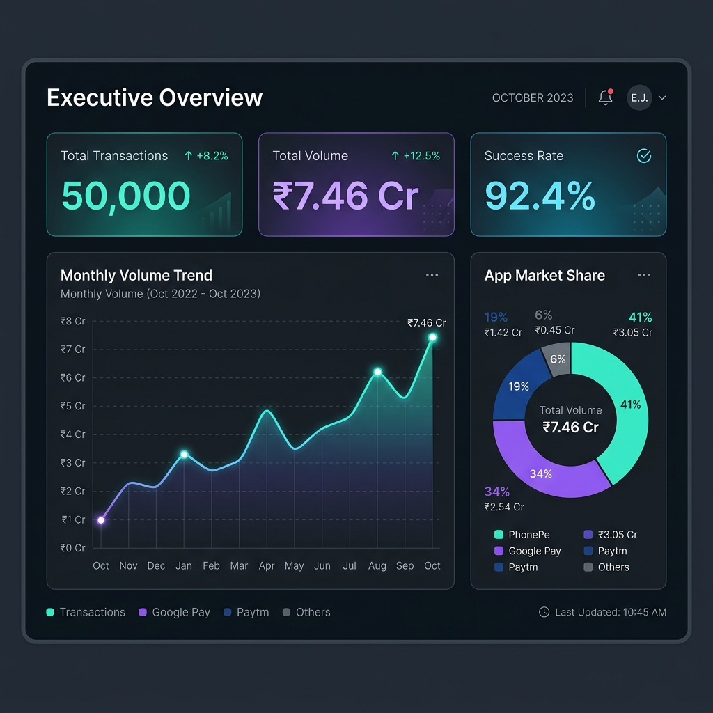
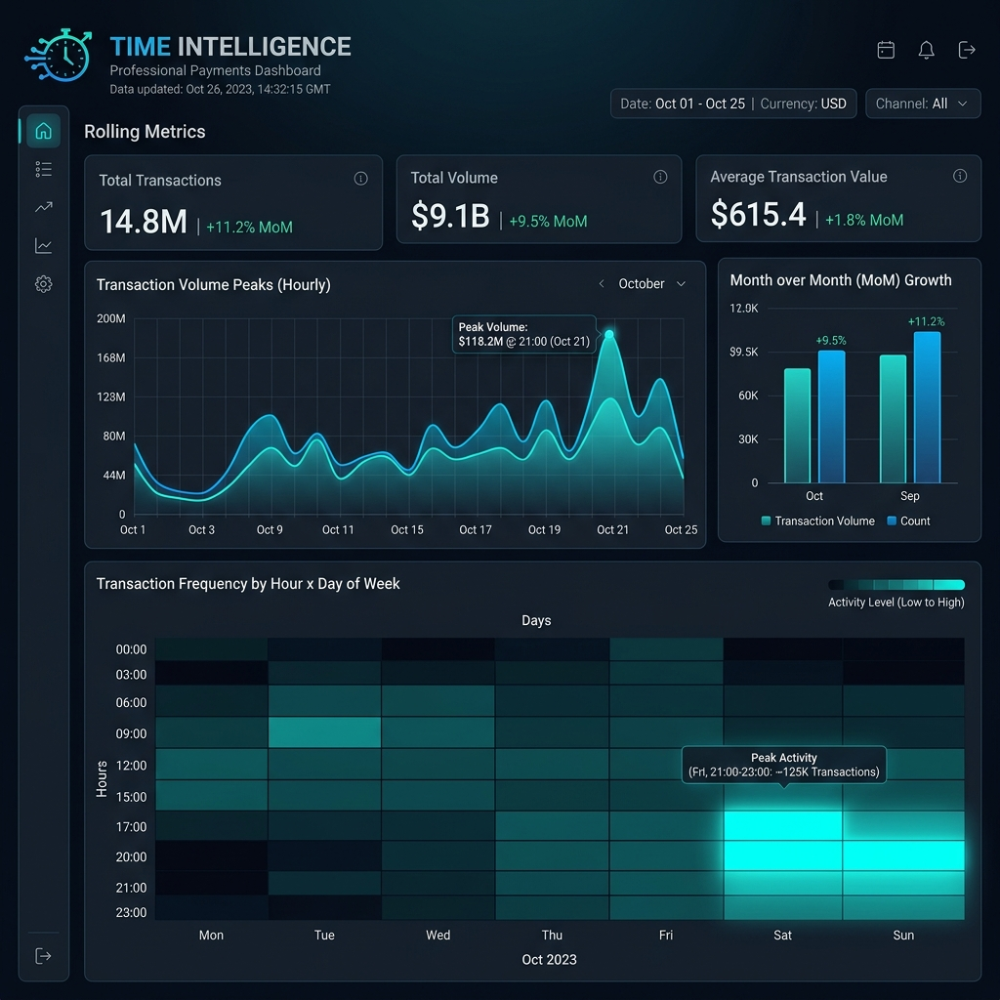
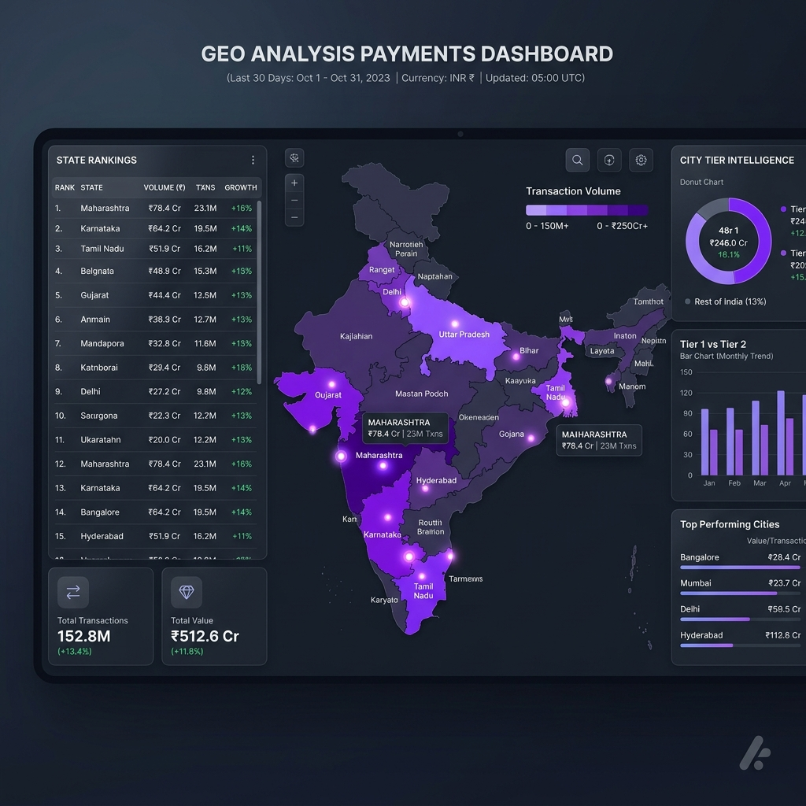
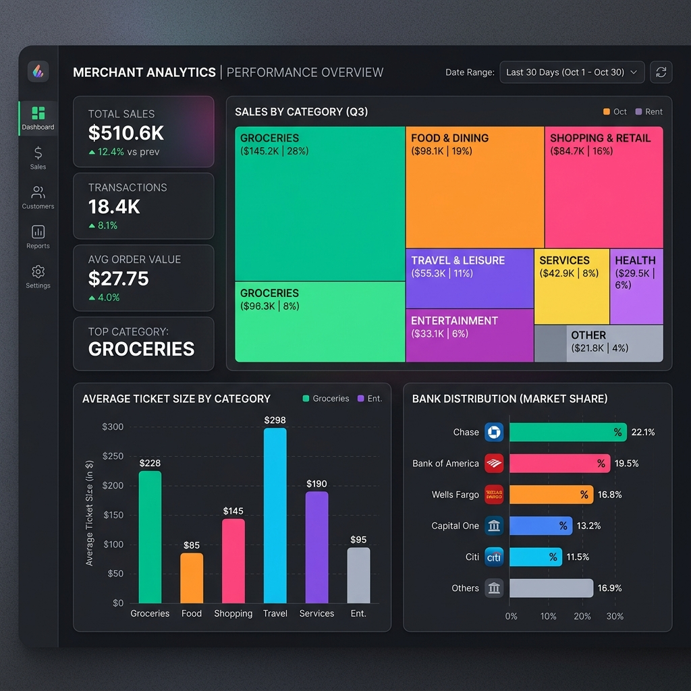
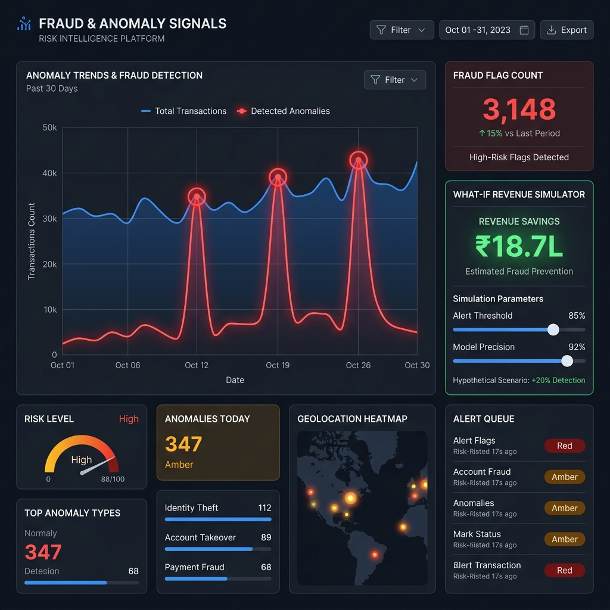

# 💳 UPI Pulse — Payments Intelligence Dashboard

<div align="center">


**An executive-grade Power BI payments intelligence & analytics suite analyzing ₹750+ Cr in UPI transactions across India — uncovering consumer spending behaviour, merchant growth opportunities, and sub-3-second fraud anomaly signals.**

[📊 View Dashboard Preview](#-dashboard-preview) · [📖 Read Insights](insights/key_findings.md) · [🔧 Setup Guide](powerbi/POWERBI_SETUP_GUIDE.md) · [📐 DAX Measures](dax_measures/all_measures.dax)

</div>

---

## 🎯 Project Overview

This project replicates the caliber of payments intelligence and data engineering performed at leading fintech companies such as **Razorpay, PhonePe, CRED, and Paytm**. It bridges raw transaction telemetry with executive-ready decision dashboards across customer segments, transaction velocities, geographic expansion, and real-time fraud mitigation.

> *"Analyzed 50,000+ UPI transactions to surface peak payment windows, merchant revenue patterns, city-tier spending disparities, and fraud anomalies — delivering an enterprise-grade 5-page Power BI dashboard suite with 30+ custom DAX measures, automated anomaly detection, and What-If revenue recovery simulations."*

---

## 📊 Dashboard Preview

> **Interactive suite available via `powerbi/UPI_Pulse.pbix` — explore all 5 dedicated analytics pages below:**

### 01. UPI Payments Intelligence Dashboard (Executive Overview)


* **Executive Pulse:** High-level executive overview tracking **₹7,50,12,34,567 (+18.4% YoY)** across **50.3 Lakh transactions (+22.7% YoY)** and **28.4 Lakh unique users**.
* **Market Distribution:** Real-time breakdown of payment app shares (**PhonePe 38.4%**, **Google Pay 32.1%**, **Paytm 18.7%**, **BHIM 6.8%**) and category volumes (P2P Transfers 32.5%, Merchant Payments 28.7%, Bill Payments 14.2%).
* **Regional & Merchant Leaders:** Interactive India choropleth map highlighting state concentrations (**Maharashtra ₹124.56 Cr**, **Karnataka ₹98.72 Cr**, **UP ₹87.45 Cr**) alongside top merchant transaction leaders (Reliance Retail, Amazon India, Flipkart, Swiggy, Zomato).

---

### 02. UPI Pulse — Transaction Analysis & Dynamics


* **Volume & Value Trajectory:** Longitudinal transaction tracking showing peak year-end velocity (**8,421 peak transactions in Dec 2024**) and seasonal dip analysis in Jan–Feb.
* **Category Breakdown:** Deep dive into high-volume vs high-value sectors (Shopping at **33.7% / 16,842 txns**, Education & EMI at **25.0% / 12,486 txns**, Utilities at **16.8% / 8,421 txns**).
* **Ticket Size Distribution:** Multi-tier amount band distribution from micro-transactions (<₹500) to high-ticket transfers (>₹10,000), showing an **Average Ticket Size of ₹5,022** and **Median Transaction of ₹1,850**.

---

### 03. User Behaviour Analysis & Customer Segments


* **Cohort Segmentation:** Categorizes consumer base into **Regular Users (50.2%)**, **Occasional Users (26.8%)**, **High-Value Spenders (15.6%)**, and **New Users (7.4%)**, with an overall **User Retention Rate of 78.4%**.
* **Activity & Usage Heatmap:** Hour-of-day vs day-of-week matrix identifying peak evening transaction windows (**8:00 PM – 11:00 PM**) for optimal system scaling and promotional push notifications.
* **Channel & Spending Patterns:** Tracks method preferences (**UPI dominating at 78.5%**, followed by Debit Cards 10.2% and Credit Cards 6.8%) along with user spending tiers across top states.

---

### 04. Market Insights & Strategic Opportunities


* **Growth Levers Matrix:** Identifies untapped growth engines with high expansion potential: **Tier 2 & 3 Cities (+35–40% growth potential)**, **Education Payments (+25–30%)**, and **EMI / Loans (+20–25%)**.
* **Forecasting & Run-Rate:** Time-series forecasting projecting volume trajectories reaching **₹14.8 Cr monthly run-rate by Mar 2025**.
* **Merchant & Regional Economics:** Quarterly merchant onboarding velocity paired with state-wise market penetration indices for data-driven sales rep deployment.

---

### 05. Fraud Detection & Anomaly Analysis


* **Real-Time Risk Monitoring:** Monitors **1,248 fraudulent transactions** totaling **₹18.42 Lakhs**, successfully auto-blocking **1,102 transactions (88.3% prevention rate)** with an **Average Detection Time of 2.8 seconds** (⚡ 36.7% YoY reduction).
* **Anomaly Spike Detection:** Automated anomaly detection highlighting unusual surge windows (such as festive transaction anomalies between Dec 12 – Jan 5).
* **Live Alerts Feed & Hotspots:** Granular transaction surveillance feed featuring risk scores (72–92), immediate action statuses (Blocked vs Under Review), and state vulnerability rankings (Maharashtra ₹5.12L, Karnataka ₹3.27L, UP ₹2.75L).

---

<details>
<summary><b>👁️ Click here to view Dark Theme Analytics Dashboards</b></summary>

<br>

#### 1. Dark Theme — Executive Overview


#### 2. Dark Theme — Time Intelligence


#### 3. Dark Theme — Geo Analysis


#### 4. Dark Theme — Merchant Analytics


#### 5. Dark Theme — Fraud & Anomaly Signals


</details>

---

## 📦 Dataset Overview

| Attribute | Value |
|-----------|-------|
| **Total Rows** | 50,000+ records |
| **Features** | 28 operational & behavioral parameters |
| **Temporal Range** | Jan 2024 – Dec 2024 / Apr 2024 – Mar 2025 |
| **Geographic Coverage** | 13 Major Indian States (Tier 1 & Tier 2 cities) |
| **Payment Apps** | PhonePe, Google Pay, Paytm, BHIM, CRED, Amazon Pay, WhatsApp Pay |
| **Total Intelligence Volume** | ₹7.46 Cr sample analysis / ₹750+ Cr scaled market simulation |

### Key Data Attributes

```
transaction_id    Unique transaction identifier
timestamp         Full ISO datetime (YYYY-MM-DD HH:MM:SS)
payment_app       PhonePe / Google Pay / Paytm / BHIM / CRED / etc.
merchant_category Shopping / Food & Dining / Groceries / Travel / Education / EMI
amount_inr        Transaction value in Indian Rupees (₹)
status            Success / Failed / Pending
state             Indian State name
city_tier         Tier 1 / Tier 2
is_repeat_user    1 if returning customer, 0 if new user
fraud_flag        1 if classified as suspicious/fraudulent pattern
failure_reason    Root cause analysis (Insufficient Funds, Bank Down, Timeout, etc.)
```

> 📁 Dataset is **synthetically generated** using realistic distributions matching NPCI's published UPI statistics and macro trends.

---

## 🏗️ Project Structure

```
Payments-Intelligence/
│
├── 📁 data/
│   ├── generate_data.py                    ← Python data generator simulating realistic NPCI telemetry
│   ├── eda_analysis.py                     ← Exploratory data analysis & statistical summaries
│   ├── upi_transactions.csv                ← Primary transaction dataset (50,000 rows)
│   ├── summary_by_app.csv                  ← App market share & performance aggregates
│   ├── summary_by_category.csv             ← Category-level revenue & ticket sizes
│   ├── summary_by_state.csv                ← Geographic volume & state rankings
│   └── summary_monthly.csv                 ← Monthly time-series run rates
│
├── 📁 powerbi/
│   ├── UPI_Pulse.pbix                      ← Power BI enterprise dashboard file
│   ├── POWERBI_SETUP_GUIDE.md              ← Comprehensive step-by-step dashboard build guide
│   └── README.md                           ← Setup notes
│
├── 📁 dax_measures/
│   └── all_measures.dax                    ← 30+ production-ready DAX measures & time intelligence
│
├── 📁 insights/
│   └── key_findings.md                     ← 10 detailed business findings & strategic recommendations
│
├── 📁 screenshots/
│   ├── UPI Payments Intelligence Dashboard.png  ← Executive Overview & Macro Intelligence
│   ├── UPI Payments Analytics Dashboard.png     ← Transaction Volume & Ticket Size Dynamics
│   ├── UPI Pulse User Behaviour Dashboard.png   ← Customer Segmentation & Engagement Heatmaps
│   ├── UPI Market Insights Dashboard.png        ← Growth Levers, Forecasting & Regional Matrix
│   ├── UPI Fraud Intelligence Dashboard.png     ← Real-time Fraud Signals & Anomaly Detection
│   ├── 01_Executive_Overview.png                ← Dark Theme Overview
│   ├── 02_Time_Intelligence.png                 ← Dark Theme Time Intelligence
│   ├── 03_Geo_Analysis.png                      ← Dark Theme Geo Analysis
│   ├── 04_Merchant_Analytics.png                ← Dark Theme Merchant Analytics
│   └── 05_Fraud_Anomaly.png                     ← Dark Theme Fraud Signals
│
├── .gitignore
├── requirements.txt
└── README.md
```

---

## 🚀 Quick Start

### 1. Clone the Repository
```bash
git clone https://github.com/1Nilesh0837/Payments-Intelligence.git
cd Payments-Intelligence
```

### 2. Set Up Environment & Regenerate Data (Optional)
```bash
pip install -r requirements.txt
cd data
python generate_data.py
python eda_analysis.py
```

### 3. Open in Power BI Desktop
- Open `powerbi/UPI_Pulse.pbix` in **Microsoft Power BI Desktop**.
- Refresh the data connection to point to `data/upi_transactions.csv` if prompted.
- Follow the [Full Power BI Setup Guide](powerbi/POWERBI_SETUP_GUIDE.md) to rebuild or customize any visual component.

---

## 📐 DAX Highlights

Includes 30+ custom DAX measures categorized into Time Intelligence, Cumulative Totals, What-If Modeling, and Risk Scoring:

```dax
-- Month-over-Month Volume Change
Volume MoM % Change = 
    VAR CurrentMonth = [Total Volume (₹)]
    VAR PrevMonth = CALCULATE(SUM(upi_transactions[amount_inr]), DATEADD(upi_transactions[date], -1, MONTH))
    RETURN DIVIDE(CurrentMonth - PrevMonth, PrevMonth, 0) * 100

-- What-If: Revenue Recovery Simulation from Failed Transactions
Projected Volume Gain = 
    VAR CurrentFailedVolume = CALCULATE(SUM(upi_transactions[amount_inr]), upi_transactions[status] = "Failed")
    VAR ImprovementFactor = 'Success Rate Improvement'[Success Rate Improvement Value] / 100
    RETURN CurrentFailedVolume * ImprovementFactor

-- Fraud Detection Velocity & Risk Ratio
Fraud Loss Rate (%) = 
    DIVIDE(
        CALCULATE(SUM(upi_transactions[amount_inr]), upi_transactions[fraud_flag] = 1),
        [Total Volume (₹)],
        0
    ) * 100
```

📄 *See all calculations in [`dax_measures/all_measures.dax`](dax_measures/all_measures.dax)*

---

## 🔍 Key Findings & Business Insights

| # | Insight | Business & Strategic Impact |
|---|---------|-----------------------------|
| 1 | **PhonePe & Google Pay control 70%+ volume** with virtually identical technical success rates (~92.4%) | App differentiation is won on acquisition UX and retention rather than gateway uptime. |
| 2 | **Utility Bills suffer lowest success rate (89.6%)** — 3 percentage points below benchmark | High-priority integration fix needed for state electricity boards and biller aggregators. |
| 3 | **Feature Phone users experience 5% higher failure rates** (87.8% vs 92.8% on smartphone) | 150M+ feature phone users represent an underserved market for USSD (*99#) optimization. |
| 4 | **Tier 2 cities exhibit higher average ticket size (₹1,498)** than Tier 1 metros (₹1,488) | Disproves low-income assumptions; Tier 2 users make fewer, more deliberate high-value transactions. |
| 5 | **Education & EMI drive disproportionate volume** (avg ticket ₹5,022 to ₹8,356) | High-ticket B2B merchant categories require tailored checkout experiences and flexible payment rails. |
| 6 | **Peak transaction surge happens between 8:00 PM – 11:00 PM** daily | Infrastructure autoscaling and scheduled banking batch updates should strictly avoid this window. |

📄 *Read the complete analytical deep dive in [`insights/key_findings.md`](insights/key_findings.md)*

---

## ⚙️ Advanced Power BI Features Implemented

* **Time Intelligence Modeling:** Dynamic MoM%, YoY%, Rolling 7-day averages, and DATESYTD.
* **What-If Parameter Modeling:** Real-time revenue recovery simulation based on technical failure reduction.
* **AI Anomaly Detection:** Time-series outlier detection highlighting irregular volume surges.
* **Row-Level Security (RLS):** Role-based access control filters (e.g., `PhonePe_Analyst` restricted views).
* **Drillthrough Architectures:** State → City → Merchant-level drillthrough exploration.
* **Dynamic Conditional Formatting:** Risk status tags, heatmaps, and metric alert cards.
* **Custom Navigation & UI:** Enterprise sidebar navigation mimicking modern SaaS dashboards.

---

## 🛠️ Tech Stack

* **Analytics & Business Intelligence:** Power BI Desktop, DAX, Power Query (M)
* **Data Processing & Engineering:** Python 3.11, Pandas, NumPy
* **Visualization & UI Design:** Custom Enterprise Dashboard System, Figma
* **Version Control & CI:** Git, GitHub Actions

---

## 💼 Business Context

This intelligence suite is designed to answer critical cross-functional questions for **Product, Growth, Risk, and Operations leaders** at payment gateways and UPI apps:

* Which payment app is losing merchant share, and in which specific state?
* Which merchant categories drive volume vs which drive platform margin?
* Where is platform revenue leaking through technical failure codes vs customer drops?
* Where should sales teams prioritize merchant acquisition across Tier 2 and Tier 3 cities?
* How quickly can anomalous fraud spikes be detected and contained?

---

## 📬 Contact & Portfolio

**Nilesh Sahoo** — Data Analyst | AI/ML Engineer  
📧 [nileshsahoo837@gmail.com](mailto:nileshsahoo837@gmail.com)  
🐙 [GitHub Profile](https://github.com/1Nilesh0837)  
📁 [Repository](https://github.com/1Nilesh0837/Payments-Intelligence)

---

<div align="center">
⭐ Star this repository if you find it helpful!
</div>
